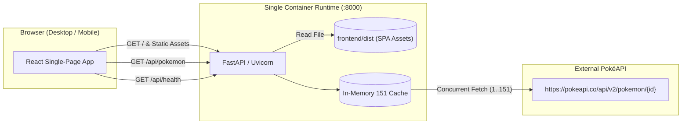

# Kanto Index

A full-stack Pokédex for the original 151 Pokémon. The UI is built with React and TypeScript; the API is built with FastAPI and Python. Pokémon data comes from [PokéAPI](https://pokeapi.co/).

The project supports two distinct workflows:
1. **Container-first onboarding** via Docker for the lowest runtime and environment setup effort on any new machine.
2. **Native development** via uv and Bun for fast iteration, immediate type checking, and instant hot module replacement.



---

## Quickstart: Container Workflow (Recommended for New Machines)

This path requires **only Docker** installed on the host. It builds the production assets inside Docker using multi-stage builds and runs the entire stack as a single service.

```bash
docker compose up --build
```

Then visit:
- **Application:** [http://localhost:8000](http://localhost:8000)
- **API Health Check:** [http://localhost:8000/api/health](http://localhost:8000/api/health)
- **API Data Route:** [http://localhost:8000/api/pokemon](http://localhost:8000/api/pokemon)

To stop the container:
```bash
docker compose down
```

Alternatively, build and run directly via the standard Docker CLI:
```bash
docker build -t kanto-index .
docker run --rm -p 8000:8000 kanto-index
```

---

## Native Development Workflow (Fast Local Iteration)

For day-to-day coding, running natively avoids container rebuilds and provides immediate Hot Module Replacement (HMR) via Vite.

### Prerequisites

- [uv](https://docs.astral.sh/uv/) (Python package and environment manager)
- [Bun](https://bun.sh/) (JavaScript runtime, package manager, and bundler)
- `make`

*No direct `pip`, `npm`, or `npx` commands are required or permitted.*

### One-Command Full Build & Test

Install all locked dependencies across both frontend and backend, type-check, build production assets, and run tests:

```bash
make build test
```

### Running Locally with Hot Reload

Start both the FastAPI backend (port 8000) and the Vite frontend dev server (port 5173) simultaneously:

```bash
make dev
```

`make dev` automatically installs locked dependencies first, so it works directly on a fresh checkout without running a separate install command.

During native development:
- Open the UI in your browser at [http://localhost:5173](http://localhost:5173).
- Vite automatically proxies `/api` calls to the FastAPI backend at `http://127.0.0.1:8000`.
- Both backend and frontend auto-reload when source files are modified.
- Note: [http://localhost:8000](http://localhost:8000) is an API-only server in dev mode; the frontend dev server is hosted at port 5173.
If you prefer separate terminal windows:
```bash
# Terminal 1: Backend API
make dev-api

# Terminal 2: Frontend Web App
make dev-web
```

---

## Workflow Comparison & Architectural Tradeoffs

| Factor | Container Workflow (`docker compose up`) | Native Workflow (`make dev`) |
|---|---|---|
| **Host Prerequisites** | Docker only | `uv`, `bun`, `make` |
| **Setup Overhead** | Zero host tool configuration | Requires installing uv and Bun |
| **Served Ports** | Port `8000` (FastAPI serves both API and static SPA) | Port `8000` (FastAPI) + Port `5173` (Vite dev server) |
| **Reload Speed** | Rebuild required for UI changes | Instant HMR via Vite, fast reloads via Uvicorn |
| **Best For** | Initial evaluation, review, CI, production deploys | Daily coding, styling changes, rapid iteration |

---

## Architecture and Design Decisions

### 1. Dual Build Strategies: Container vs. Native
- **Why offer both?** New environments (evaluation sandboxes, remote VMs, colleagues on different OS configurations) frequently have subtle toolchain discrepancies. Providing a self-contained container build ensures a guaranteed one-command setup. However, developing strictly inside Docker introduces filesystem syncing latency and slower reload loops. Providing both guarantees friction-free onboarding alongside peak developer velocity.

### 2. Single-Container Runtime vs. Multi-Container (Nginx + FastAPI)
- **Why one container?** An enterprise deployment might separate static file distribution (Nginx/CDN) from application endpoints (FastAPI). For this project, a single multi-stage Docker container serving `frontend/dist` through FastAPI static mounts is significantly simpler:
  - Eliminates container networking complexity and service discovery issues.
  - Requires only one port (`8000`) and one process supervisor.
  - Avoids CORS complexities in production, as all browser traffic originates from the same host/port.
  - Keeps resource utilization low while avoiding orchestration overhead.

### 3. Server-Side Data Aggregation & In-Memory Caching
- **Single Normalized Contract:** The client requires Pokémon ID, name, sprites, and types. Rather than requiring the client to orchestrate 151 round-trips to PokéAPI, FastAPI fetches IDs 1 through 151 concurrently (bounded by an async semaphore of 20 connections) and normalizes the payload into a clean Pydantic schema.
- **Fail-Safe In-Memory Cache:** Once successfully fetched, the collection is stored in process memory. If any upstream PokéAPI request fails, no partial or corrupted collection is cached, returning a clean 503 instead. Subsequent requests return immediately from memory.

### 4. Client-Side Instant Filtering
- Once loaded, all 151 specimens are held in client state. Search-by-name and filter-by-type operate entirely in memory without further server requests.
- **Intersection Semantics:** Filtering by both name and type returns only Pokémon satisfying both constraints. Multi-type specimens match whenever either of their types is selected.
- **Dynamic Type Indexing:** Available type filters are computed dynamically from the active Pokémon list to prevent list drift and guarantee that dual types like Flying and Steel are always filterable.

### 5. Visual System & Accessibility
- **Editorial Data Aesthetic:** Guided by the dark, high-contrast, data-dense layouts in `/examples`, the interface features a deep charcoal canvas (`#090a0c`), subtle structural grid lines, monospace badges, glowing specimen viewports, and vivid category indicators.
- **Fallback Resilience:** Cards prioritize PokéAPI's high-definition official artwork, gracefully falling back to standard generation sprites if artwork fails to load.

---

## Project Structure

```text
├── Dockerfile              # Multi-stage production container build (Bun + uv + Python)
├── compose.yaml            # Single-service Docker Compose deployment definition
├── Makefile                # Unified build, test, and dev entrypoints
├── .dockerignore           # Context exclusions for efficient container layers
├── .gitignore              # Repository artifact exclusions
├── README.md               # Architecture documentation and instructions
│
├── backend/
│   ├── main.py             # FastAPI app, static SPA mounting, and PokéAPI integration
│   ├── test_main.py        # Backend test suite with mocked transport
│   ├── pyproject.toml      # uv package and dependency specification
│   └── uv.lock             # Deterministic Python lockfile
│
└── frontend/
    ├── package.json        # Bun package manifest with pinned packageManager
    ├── bun.lock            # Deterministic frontend lockfile
    ├── vite.config.ts      # Vite dev server and proxy configuration
    └── src/
        ├── App.tsx         # Main Pokédex application, filters, and state
        ├── components/     # UI components (PokemonCard, etc.)
        ├── api.ts          # Typed fetch client
        ├── types.ts        # Shared TypeScript data models
        └── styles.css      # Custom responsive dark-mode styling
```
